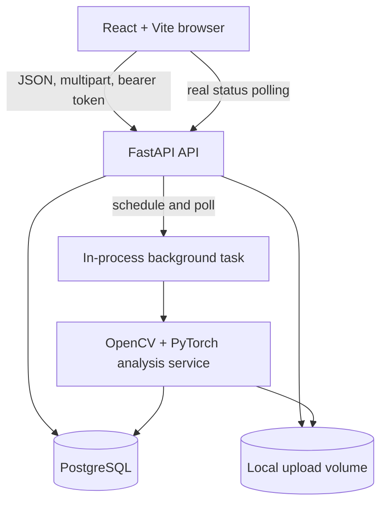

# Architecture

FrameTrace is a small, local-first full-stack application. The browser owns the review experience; FastAPI owns authentication, validation, job state, and report APIs; PostgreSQL stores user-scoped records; OpenCV and the deterministic PyTorch baseline produce the analysis payload.

## System context

## Request and job lifecycle

1. The user registers or signs in. Passwords are bcrypt-hashed and the API returns a short-lived JWT used for subsequent requests.
2. The upload route checks the extension, MIME type, byte limit, and image decodability. Storage uses a generated UUID-based filename rather than the user-provided name.
3. The API persists a media record and an analysis record in `QUEUED`, then returns the analysis identifier so the UI can open its report immediately.
4. FastAPI's in-process background task changes the record to `PROCESSING`, runs the image or bounded video pipeline, writes structured findings and sampled frame rows, and finishes in `COMPLETED` or `FAILED`.
5. The React report polls the API and renders the state returned by the backend. It does not infer progress or synthesize a score for an incomplete job.

The background task is a deliberate portfolio/demo boundary. It is not a durable queue: a process restart can interrupt work, there is no retry broker, and local storage is not an object-store lifecycle. A production deployment should move execution to a durable worker system and object storage while keeping the analysis service interface and explicit status contract.

## Analysis boundary

The analysis module keeps the research baseline transparent:

- OpenCV decodes the image or video and enforces supported dimensions/duration.
- Images are measured for JPEG recompression residual, noise residual, Laplacian texture variance, saturation variation, and dimension alignment.
- A deterministic PyTorch `Linear + Sigmoid` model consumes the five normalized measurements and records `frametrace-baseline-0.1` on each report.
- Videos provide container context and sample at most 12 evenly spaced frames through the same image path.
- The result separates model output, measured findings, metadata findings, sampled-frame findings, processing time, and limitations.

The score is a probability-like research output, not a calibrated probability, detector claim, or proof of manipulation. No labeled dataset or trained checkpoint is included. See the scientific limitations in [`README.md`](README.md).

## Persistence model

| Entity | Purpose |
| --- | --- |
| `users` | Account identity, display name, bcrypt password hash, and creation time |
| `media_files` | Owner-scoped display metadata, generated storage name, media type, size, and dimensions |
| `analyses` | Job status, model version/output, summary, structured result, error, and timing |
| `frame_findings` | Timestamped video samples and per-frame findings linked to an analysis |

All read/update/delete routes constrain records by the authenticated owner. The current delete route removes the analysis record; deployment work should add an explicit media-retention and cleanup policy for stored files.

## Repository map

- `backend/app/main.py` — FastAPI application, auth, upload, job, report, and history routes.
- `backend/app/analysis.py` — image/video processing, measured signals, baseline model, and result aggregation.
- `backend/app/security.py` — password hashing and JWT validation.
- `backend/app/models.py` — SQLAlchemy persistence entities.
- `frontend/src/main.tsx` — registration/login, upload flow, status polling, report, history, and disclaimers.
- `docker-compose.yml` — local PostgreSQL, backend, frontend, and named runtime volumes.

For the practical walkthrough, see [`DEMO.md`](DEMO.md). For the security boundary and local-data guidance, see [`SECURITY.md`](SECURITY.md).
