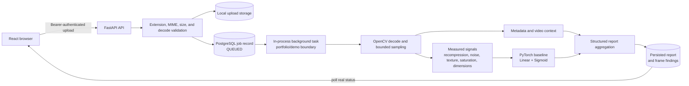

# FrameTrace

> A local-first media evidence workspace for asking better questions of an image or sampled video.

FrameTrace turns one media file into a traceable review: upload validation, bounded processing, measurable visual signals, available metadata, a versioned model output, and an explicit record of uncertainty. The React interface keeps queued/processing/completed/failed states visible and lets an analyst revisit reports in a private history.

## Research honesty, up front

FrameTrace is **research software, not a detector, proof engine, authenticity oracle, or provenance system**. The bundled `frametrace-baseline-0.1` model is a deterministic PyTorch `Linear + Sigmoid` baseline with fixed coefficients over five normalized measurements. It is not trained on a labeled manipulation dataset, independently validated, or calibrated to support an accuracy claim.

Its score is a probability-like model output used alongside contextual measurements. The UI's `confidence` value is a distance-from-neutral heuristic, not empirical statistical confidence. A high or low score cannot establish that a file is authentic, manipulated, who edited it, when editing happened, or what the creator intended. False positives and false negatives are expected possibilities.

## Why this project exists

Media-review tools often compress a complicated question into a green or red verdict. FrameTrace takes the opposite product position: make the evidence trail inspectable, keep the model's limitations beside its output, and show real processing state instead of pretending that a background job has precise progress.

That makes the project useful as a portfolio demonstration of:

- A full-stack workflow spanning React, FastAPI, PostgreSQL, OpenCV, and PyTorch.
- A bounded media-processing pipeline with explicit failure states and persisted results.
- Product language that separates measurements, model output, context, and conclusions.
- A deliberate seam for replacing a transparent baseline with a validated model later.

## What a reviewer can try

1. Open **New review** and choose one supported image or video up to 100 MB.
2. FrameTrace validates the extension, MIME type, and size before persisting a private file record; image decoding and dimension checks happen at intake, while video decoding and duration checks happen in processing.
3. The API creates a real analysis job. The report shows `QUEUED` or `PROCESSING` until the backend returns a terminal state; it does not invent a percentage.
4. Open the completed report to inspect the model score, measured forensic indicators, metadata findings, processing context, and limitations.
5. For video, inspect the bounded set of evenly spaced frame scores and timestamps.
6. Return to **History** to search, filter, refresh, and reopen reports. Failed validation and failed processing remain visible as errors rather than fabricated scores.

### Supported media

| Input | Formats | Limits and behavior |
| --- | --- | --- |
| Still image | JPG, JPEG, PNG, WEBP | 100 MB upload limit; OpenCV decode and dimension checks |
| Video | MP4, MOV, AVI, MKV | 100 MB upload limit; maximum 15-minute duration; up to 12 evenly spaced frames sampled |

## Evidence pipeline



### What the pipeline measures

- **Image signals:** JPEG recompression residual, noise residual, Laplacian texture variance, saturation variation, and dimension alignment.
- **File context:** image dimensions, available EXIF metadata, video FPS/frame count/duration, and sampled frame timestamps.
- **Model output:** a versioned deterministic baseline score derived from the five normalized measurements.
- **Report language:** measured values and interpretations remain separate from the model score and the overall category.

OpenCV performs decoding and preprocessing. Videos reuse the image path for up to 12 sampled frames, then persist frame scores and findings. The current demo uses an in-process FastAPI background task; it is intentionally not described as a durable distributed queue. See [`ARCHITECTURE.md`](ARCHITECTURE.md) for the boundary and a production scaling path.

## Scientific limitations

### What the baseline can do

It can deterministically transform the implemented measurements into a repeatable, versioned model output and place that output beside inspectable signals. This is useful for demonstrating interfaces, reproducibility, bounded processing, and honest report design.

### What it cannot establish

- Authenticity, manipulation, intent, authorship, provenance, or chain of custody.
- That an indicator was caused by malicious editing rather than recompression, resizing, camera processing, or a social platform.
- Generalization to unseen devices, codecs, editing tools, adversarial inputs, or real-world distributions.
- Accuracy, precision, recall, F1, calibration, or a defensible decision threshold.

Metadata can be removed or rewritten. A still image may have no EXIF data; that absence is contextual, not proof. Video sampling is a bounded view of the source, not a frame-by-frame guarantee. The baseline must not be used for legal, employment, safety, access-control, or other high-impact decisions.

There is intentionally no trained checkpoint or labeled evaluation dataset in this repository. A future model should arrive with a dataset license, split strategy, preprocessing contract, checkpoint checksum, calibration/evaluation protocol, and a report of failure modes before any accuracy claim is made. The `backend/evaluate.py` entry point refuses to invent metrics without those inputs.

## Security and privacy posture

The demo includes practical safeguards for a local portfolio environment:

- Passwords are hashed with bcrypt and API sessions use short-lived bearer JWTs.
- Files and analyses are scoped to the authenticated owner.
- Uploads use generated storage names; the original filename is retained only as display metadata.
- Extension, MIME type, byte size, image decode, image dimensions, and video duration are bounded before/within processing.
- Analysis states are explicit (`QUEUED`, `PROCESSING`, `COMPLETED`, `FAILED`) and errors are rendered as errors.
- CORS is configured for the local frontend origin, and runtime state is kept in ignored local storage/volumes.

This is not a hardened internet-facing deployment. The Compose database credentials and local secret workflow are for the demo; use managed secrets, HTTPS, durable workers, object-storage lifecycle controls, rate limits, observability, and a reviewed deployment policy before exposing a service publicly. Do not upload sensitive or private media to a shared machine. See [`SECURITY.md`](SECURITY.md) for the threat model and reporting guidance.

## Run the demo with Docker

### Prerequisites

- Docker Desktop with the Compose plugin.
- A browser available on the host.

### Start

```powershell
Copy-Item .env.example .env
# Edit .env and replace SECRET_KEY with a long random value. Keep .env untracked.
docker compose config
docker compose up --build
```

Open <http://localhost:5175>, choose **Create an account**, and use a password of at least 10 characters. Then upload a non-sensitive file you own. The frontend talks to the API at <http://localhost:4100/api>.

To stop the demo while keeping its named database/upload volumes:

```powershell
docker compose down
```

Use `docker compose down --volumes` only when intentionally resetting local demo state. No media fixtures, credentials, model weights, database volumes, or private sample data are required or included in this repository.

### Five-minute interviewer walkthrough

1. Register and point out the **research baseline** badge and the probabilistic disclaimer before uploading anything.
2. Upload a JPG/PNG and show the report opening immediately in a real `QUEUED`/`PROCESSING` state.
3. Discuss why the report keeps the model score, measured signals, metadata, and limitations in separate sections.
4. Upload a short MP4/MOV and show the sampled frame timestamps and per-frame scores.
5. Open **History**, filter by status, and revisit a report.
6. Use the architecture and scientific-limitations sections to explain what would be required before replacing the baseline with a validated detector.

The complete demo script is in [`DEMO.md`](DEMO.md). No shared demo account or preloaded media is committed; registration is intentionally part of the flow.

## Local development without Docker

Docker is the recommended path because it provides the CPU PyTorch/OpenCV environment used by the backend image. Direct development can use SQLite for the default local database and a local ignored `uploads` directory.

Use Python 3.12 for the closest match to the backend image, plus a current Node.js/npm installation.

### Backend (PowerShell)

```powershell
cd backend
python -m venv .venv
.\.venv\Scripts\Activate.ps1
python -m pip install --upgrade pip
python -m pip install --index-url https://download.pytorch.org/whl/cpu torch==2.5.1+cpu
python -m pip install -r requirements-dev.txt

$env:DATABASE_URL = "sqlite:///./frametrace.db"
$env:STORAGE_DIR = (Join-Path (Get-Location) "uploads")
$env:CORS_ORIGIN = "http://localhost:5175"
$env:SECRET_KEY = (python -c "import secrets; print(secrets.token_urlsafe(32))")
python -m uvicorn app.main:app --reload --port 4100
```

### Frontend (a second terminal)

```powershell
cd frontend
npm ci
npm run dev -- --port 5175
```

Open <http://localhost:5175>. The API URL defaults to `http://localhost:4100/api`; set `VITE_API_URL` in the frontend shell if you run the API elsewhere. Keep generated databases, uploads, `.env` files, and build output out of commits.

## Validation commands

Run the checks from the repository root (the backend test configuration supplies its own Python path):

```powershell
docker compose config

Push-Location backend
python -m pytest -q
Pop-Location

Push-Location frontend
npm ci
npm run build
Pop-Location
```

The tests currently cover the deterministic model interface, supported media classification, and the presence of probabilistic report language. The frontend production build checks TypeScript/Vite compilation. A full fresh-upload/video acceptance run also depends on starting the backend with its OpenCV/PyTorch dependencies; the historical validation notes are in [`docs/TEST_REPORT.md`](docs/TEST_REPORT.md). There is no CI workflow in this repository yet, so these are local checks rather than a hosted status badge.

## Architecture and project map

| Area | Responsibility |
| --- | --- |
| `frontend/src/main.tsx` | Registration/login, upload/dropzone, live job polling, report, history search/filter, and limitations UI |
| `backend/app/main.py` | FastAPI auth, upload validation, ownership checks, job lifecycle, report/history routes |
| `backend/app/analysis.py` | OpenCV measurements, PyTorch baseline, image/video aggregation, metadata findings |
| `backend/app/models.py` | SQLAlchemy entities for users, media files, analyses, and sampled frame findings |
| `backend/app/security.py` | Bcrypt password hashing and JWT session validation |
| `docker-compose.yml` | Local PostgreSQL, backend, frontend, and named runtime volumes |

Read [`ARCHITECTURE.md`](ARCHITECTURE.md) for lifecycle details and [`SECURITY.md`](SECURITY.md) for deployment boundaries.

## Portfolio story

FrameTrace is a full-stack case study in making an uncertain ML workflow understandable. I built the intake, ownership, background job lifecycle, media-processing path, persistence model, and report UI as one coherent experience. The interesting design constraint was not producing a dramatic verdict; it was making every output inspectable and keeping the product honest about what the baseline does not know.

The result is a recruiter-friendly demonstration of product judgment as well as implementation: bounded media handling, explicit failure states, model versioning, structured forensic findings, real status polling, and a clear seam for a future durable worker and validated model. [`docs/PROJECT_STORY.md`](docs/PROJECT_STORY.md) contains a concise version suitable for a portfolio or interview preparation.

## License and contributions

This repository is prepared as a portfolio/demo codebase. Before distributing it as a public dependency or accepting external contributions, add the license and contribution policy that match the project owner's intent.
